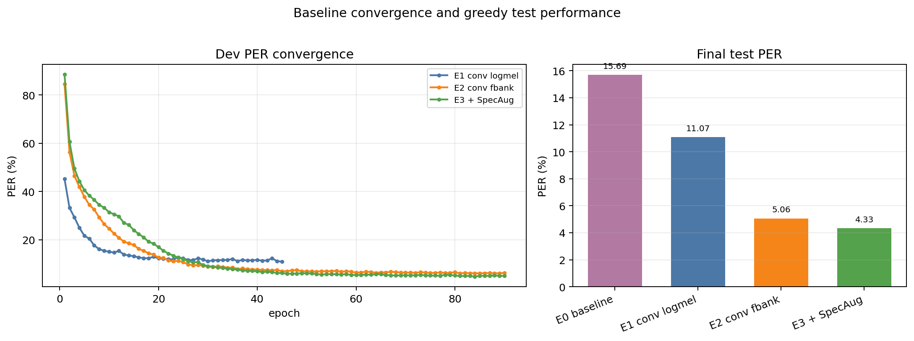
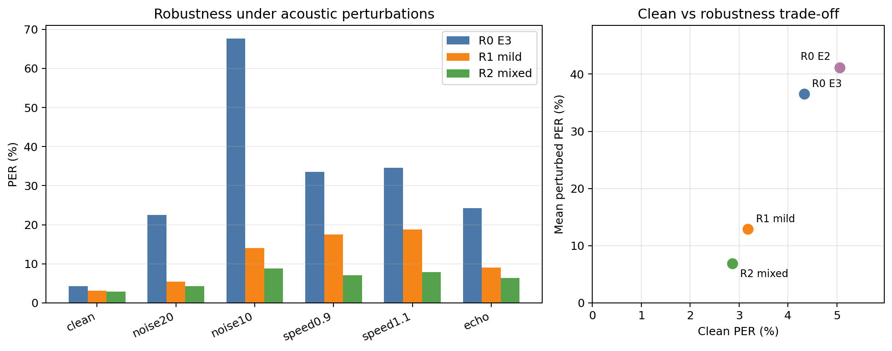
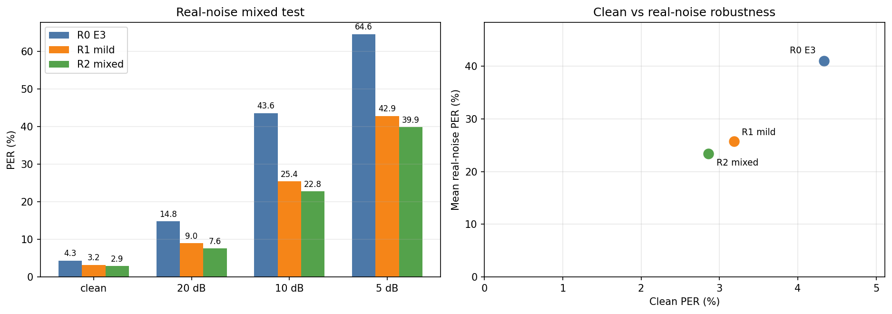
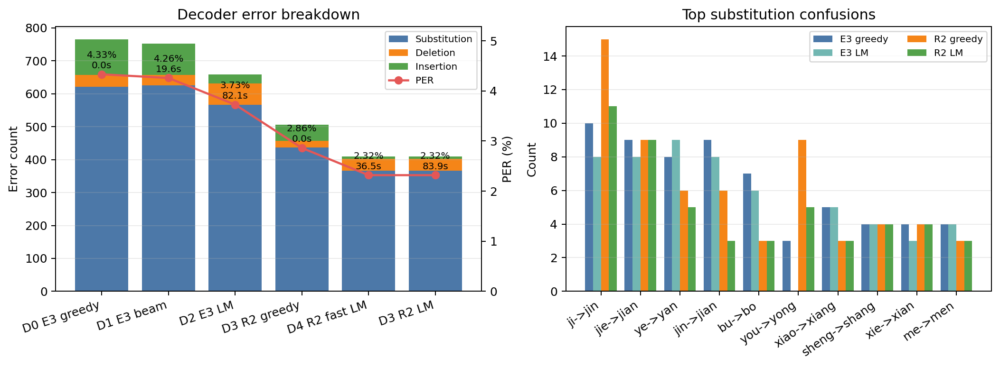

# 面向鲁棒中文拼音语音识别的 Transformer-CTC 系统

本项目实现了一个端到端中文拼音自动语音识别系统。系统以 Transformer Encoder + CTC 为基础，在可复现的轻量基线上逐步加入卷积下采样、Fbank、SpecAugment 和波形级混合增强，并使用拼音 4-gram 语言模型分析 CTC 的 substitution 错误。

项目重点不是单独追求 clean 测试集上的最低 PER，而是建立一套覆盖训练、选模、扰动测试、真实环境噪声验证和错误分析的完整实验流程。

## 主要特性

- Transformer Encoder + CTC 端到端拼音识别
- `linear` 与 `conv2d_subsample4` 两种声学前端
- log-Mel 与 Kaldi 风格 Fbank 特征
- SpecAugment 频谱增强
- noise、speed、volume、echo 波形级训练增强
- 基于多场景 dev PER 的鲁棒 checkpoint 选择
- greedy、CTC prefix beam search 和拼音 4-gram LM 解码
- PER、S/D/I、句长分桶和高频 substitution 混淆分析
- 合成扰动与 MS-SNSD 真实环境噪声混合评测

## 方法概览

主模型由以下模块组成：

1. 80 维 Fbank 特征提取与均值归一化。
2. 两层 stride=2 的二维卷积，将时间长度压缩至约四分之一。
3. 4 层 Transformer Encoder，`d_model=128`，4 个注意力头。
4. 线性分类器输出 blank 与拼音 token 的帧级概率。
5. 使用 CTC loss 训练，默认采用 greedy CTC collapse 解码。

最终鲁棒模型 R2 从 E3 checkpoint 开始微调，在训练阶段随机加入噪声、语速、音量和回声扰动。checkpoint 不只按 clean dev PER 选择，而是使用以下条件的平均 PER：

```text
clean, noise20, speed0.9, speed1.1, echo
```

这样可以使训练增强、模型选择和最终鲁棒性评价保持一致。

## 实验数据

实验采用课程 Lab6 标贝中文语音识别数据划分，清洗后的规模为：

| 数据集 | 语句数 |
|---|---:|
| Train | 7,999 |
| Dev | 1,000 |
| Test | 1,000 |

预处理时移除了一个无法读取的零字节音频 `006230.wav`。输出标签为不带声调的拼音 token 序列。

原始语音数据不随仓库发布。获得课程数据后，建议组织为：

```text
data/lab6/
├── Wave/
└── split/
    ├── train/{wav.scp,pinyin}
    ├── dev/{wav.scp,pinyin}
    └── test/{wav.scp,pinyin}
```

生成清洗后的 manifest：

```bash
python scripts/prepare_exp6_data.py \
  --raw-root data/lab6 \
  --out-root data/lab6_clean
```

## 主要结果

### 强声学基线

| 实验 | 主要变化 | Test PER |
|---|---|---:|
| E0 | 2 层 Transformer-CTC，linear 前端 | 15.69% |
| E1 | E0 + 4 倍卷积下采样 | 11.07% |
| E2 | 4 层 Transformer、Fbank、卷积下采样 | 5.06% |
| E3 | E2 + 弱 SpecAugment | 4.33% |

E0/E1 使用 2 层、`d_model=64` 的 Transformer；E2/E3 使用 4 层、`d_model=128` 的 Transformer。E2 和 E3 的模型结构与参数量完全相同，差别只在 E3 训练时启用了 SpecAugment。



### 波形级鲁棒性增强

下表均使用 greedy 解码。`Real-noise mean` 是 MS-SNSD `noise_test` 在 20、10、5 dB 三种 SNR 下的平均 PER。

| 模型 | Clean | Noise 10 dB | Speed 0.9 | Echo | Real-noise mean |
|---|---:|---:|---:|---:|---:|
| E2，无 SpecAugment | 5.06% | 71.29% | 40.39% | 27.34% | 41.74% |
| E3，弱 SpecAugment | 4.33% | 67.63% | 33.57% | 24.28% | 41.00% |
| R1，mild waveform augmentation | 3.18% | 14.04% | 17.47% | 9.04% | 25.75% |
| R2，mixed waveform augmentation | **2.86%** | **8.85%** | **7.07%** | **6.40%** | **23.38%** |

SpecAugment 对 clean 和合成扰动有一定收益，但对未见真实环境噪声的迁移提升较小。波形级混合增强是鲁棒性提升的主要来源，并且在本实验中没有造成 clean PER 退化。





真实噪声实验将 51 条 MS-SNSD 环境噪声以固定 SNR 混入 clean test 语音，只用于评测，不参与训练。该实验用于验证迁移趋势，不能替代完整的真实 noisy speech benchmark。

### 解码与 substitution 分析

| 实验 | 声学模型 | Decoder | Test PER | S | D | I | 解码耗时 |
|---|---|---|---:|---:|---:|---:|---:|
| D0 | E3 | Greedy | 4.33% | 621 | 37 | 108 | 0.03 s |
| D1 | E3 | Prefix beam | 4.26% | 625 | 32 | 96 | 19.63 s |
| D2 | E3 | Beam + 4-gram LM | 3.73% | 566 | 65 | 28 | 82.14 s |
| D3 | R2 | Greedy | 2.86% | 437 | 20 | 49 | 0.04 s |
| D4 | R2 | Fast beam + 4-gram LM | **2.32%** | **367** | 36 | **7** | 36.49 s |

扩大 beam 本身几乎不能降低 substitution；加入拼音序列先验后，substitution 和 insertion 明显下降，但解码成本显著增加。因此，本项目以 R2 greedy 作为主要工程结果，将 beam + LM 视为错误分析和性能上限参考。



## 环境安装

推荐使用 Python 3.10 或兼容版本，并根据本机 CUDA 环境安装 PyTorch 和 torchaudio。

```bash
conda create -n asr-ctc python=3.10
conda activate asr-ctc
pip install -r requirements.txt
```

主要依赖包括 PyTorch、torchaudio、NumPy、PyYAML、soundfile 和 matplotlib。

## 已发布的关键 Checkpoint

仓库只保留能够支撑主要对照实验的三个权重，单文件均小于 12 MiB：

| 模型 | 路径 | 用途 |
|---|---|---|
| E2 | `checkpoints/e2_conv_fbank_strong/best.pt` | 无 SpecAugment 的强基线与鲁棒性对照 |
| E3 | `checkpoints/e3_conv_fbank_weak_specaugment/best.pt` | SpecAugment 基线、decoder 实验和鲁棒微调起点 |
| R2 | `checkpoints/r2_e3_audio_mixed/robust_best.pt` | 最终 mixed waveform augmentation 模型 |

SHA256：

```text
E2  e08b1eb8e44fa7f63948196f263112838984457a26a9a352042b9d6528703cfe
E3  9f360ae3327e403532bc8dbde834b613400384fd7766097c71f62b3e5c9490c0
R2  15f1eb01dd919c4f748fff5ff23bbf80d557529c1c35ac0168b1b6f08062b70f
```

准备好数据后，可以直接使用这些 checkpoint 运行 clean、鲁棒性和 decoder 评测，不需要重新训练模型。

## 训练与评测

### 训练 E2/E3 强基线

```bash
python train.py --config configs/e2_conv_fbank_strong_90.yaml
python train.py --config configs/e3_conv_fbank_weak_specaugment_90.yaml
```

训练过程会在配置指定的 `checkpoints/<experiment>/` 中写入：

```text
best.pt
last.pt
metrics.csv
```

断点续训示例：

```bash
python train.py \
  --config configs/e3_conv_fbank_weak_specaugment_90.yaml \
  --resume checkpoints/e3_conv_fbank_weak_specaugment/last.pt
```

### 训练 R2 鲁棒模型

R2 从 E3 最优 checkpoint 开始微调，并重置优化器：

```bash
python train.py \
  --config configs/r2_e3_audio_mixed_99.yaml \
  --resume checkpoints/e3_conv_fbank_weak_specaugment/best.pt \
  --reset-optimizer

python train.py \
  --config configs/r2_e3_audio_mixed_114.yaml \
  --resume checkpoints/r2_e3_audio_mixed/last.pt

python train.py \
  --config configs/r2_e3_audio_mixed_125.yaml \
  --resume checkpoints/r2_e3_audio_mixed/last.pt
```

### Greedy 测试

```bash
python evaluate.py \
  --config configs/r2_e3_audio_mixed_125.yaml \
  --checkpoint checkpoints/r2_e3_audio_mixed/robust_best.pt \
  --split test \
  --predictions-out results/r2_predictions.csv \
  --analysis-out results/r2_analysis.json
```

### 合成扰动测试

```bash
python scripts/evaluate_robustness.py \
  --config configs/r2_e3_audio_mixed_125.yaml \
  --checkpoint checkpoints/r2_e3_audio_mixed/robust_best.pt \
  --conditions clean,noise20,noise10,noise5,speed0.9,speed1.1,volume0.5,volume1.5,echo \
  --summary-out results/r2_robustness_summary.csv \
  --records-out results/r2_robustness_records.csv \
  --analysis-out results/r2_robustness_analysis.json
```

### MS-SNSD 真实噪声混合测试

下载轻量 `noise_test`：

```bash
python scripts/download_ms_snsd_noise_test.py
```

运行评测：

```bash
python scripts/evaluate_robustness.py \
  --config configs/r2_e3_audio_mixed_125.yaml \
  --checkpoint checkpoints/r2_e3_audio_mixed/robust_best.pt \
  --conditions clean,real_noise20,real_noise10,real_noise5 \
  --real-noise-root data/noise/ms_snsd_noise_test \
  --summary-out results/real_noise_r2_summary.csv \
  --records-out results/real_noise_r2_records.csv \
  --analysis-out results/real_noise_r2_analysis.json
```

### 拼音语言模型解码

```bash
python scripts/evaluate_decoder.py \
  --config configs/r2_e3_audio_mixed_125.yaml \
  --checkpoint checkpoints/r2_e3_audio_mixed/robust_best.pt \
  --split test \
  --decoder prefix_beam_lm \
  --beam-width 10 \
  --topk 12 \
  --lm-order 4 \
  --lm-alpha 0.3 \
  --lm-beta 0.0 \
  --experiment D4_R2_fast_beam_lm
```

首次运行时会从训练集拼音文本构建 4-gram LM；后续可从 `results/lm/pinyin_4gram.json` 加载缓存。

### 重新生成汇总图表

```bash
python scripts/build_final_matrices.py
python scripts/plot_optimization_summary.py
python scripts/plot_report_figures.py
python scripts/plot_real_noise.py
```

## 仓库结构

```text
.
├── configs/                 # E0-E3、R1/R2 和 smoke 配置
├── dataprocess/             # 数据集、特征与词表处理
├── models/                  # Transformer-CTC 与卷积下采样前端
├── scripts/                 # 数据准备、评测、选模、解码和绘图脚本
├── utils/                   # CTC 解码、指标、增强和 n-gram LM
├── results/                 # 正式实验 CSV/JSON/TXT 与图表
├── train.py                 # 训练入口
├── evaluate.py              # Greedy 评测入口
└── infer.py                 # 单条语音推理入口
```

## 仓库内容与复现边界

Gitee 仓库已包含：

- 完整 Python 源代码与依赖说明
- E0-E3、R1/R2 和 smoke 实验配置
- 正式实验的汇总、逐句预测、错误分析和鲁棒性结果
- 训练曲线、鲁棒性、真实噪声和 decoder 分析图表
- E2、E3 和最终 R2 的关键 checkpoint

以下内容不提交到 Git：

- `data/`：课程语音数据和下载的真实噪声
- 其他 `checkpoints/`：`last.pt`、逐轮 checkpoint、R1 和 smoke 权重等中间产物
- `results/lm/`：可由训练集文本重新生成的语言模型缓存
- `report/`：本地课程报告源文件
- `results/smoke_*`：仅用于开发验证的临时结果

因此，仓库可以完整审查实现和正式实验结果，并直接使用 E2、E3、R2 三个模型进行评测。原始数据仍需由使用者按授权范围自行准备。

## 项目成员

- 李泽昊：调研与 proposal、基础训练流程、初始 baseline 和 SpecAugment 实验
- 丁益三：结构与特征优化、鲁棒性实验、语言模型解码、可视化与结果整合

实验方向、结果解释和最终结论由两位成员共同讨论完成。

## 说明

本仓库为语音信息处理课程项目，主要用于教学、实验复现和方法分析。仓库当前未附加开源许可证，使用或再发布前请先联系项目成员。
